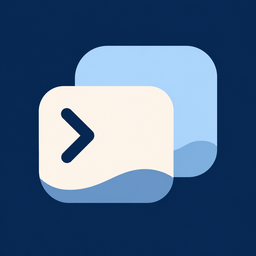

<p align="center">
  
</p>
<h1 align="center">Cove-Go</h1>
<p align="center">One app for OpenClaw and DSH Remote.</p>
<p align="center"><a href="README.md">简体中文</a> · <b>English</b></p>
<p align="center">
  <a href="https://github.com/yukinsnow/Cove-Go/releases/tag/v0.1.15">Download 0.1.15 (16)</a> ·
  <a href="docs/openclaw-remote.en.md">Development and architecture</a> ·
  <a href="LICENSE">AGPL-3.0</a>
</p>

> **This release is an unsigned iOS development/test IPA.** It is not an App Store or TestFlight release: sign it yourself before installation. GitHub Actions and a separate local Mac release build succeeded, and archive checks passed. **Physical iPhone testing has not been completed.**

## What it is

Cove-Go is an independent derivative of [ccch1mneyyy/dsh-Go](https://github.com/ccch1mneyyy/dsh-Go), based directly on the original upstream, not another iOS fork. Its native Flutter interface switches between two remote backends:

- **OpenClaw**: connect to your own Gateway, with multiple hosts, device pairing, conversation history, streaming responses, tool activity, model selection, images, queued messages, steer and interrupt.
- **DSH Remote**: upstream remote connections and native chat, with account login, self-hosted hosts, SSH and LAN / WebRTC / TURN / relay, depending on server configuration and networking.
- Each backend owns its protocol, identity, credentials and conversations independently. Neither impersonates or converts the other.
- Chinese / English, Day / Night / System appearance, and independently drawn whale / lobster companions.

This is not an official OpenClaw, DSH Go or DeepSeek client. Upstream Android and runtime sources remain available for reference and development, but **this release ships only the iOS remote client**. It does not install or run Linux / the DSH engine on an iPhone, or provide Android accessibility-based phone control.

## Download and install

Open [GitHub Releases](https://github.com/yukinsnow/Cove-Go/releases/tag/v0.1.15) and download:

- `Cove-Go-0.1.15-build16-6708c24dc8db-unsigned.ipa`
- Its matching `.ipa.sha256` checksum file.

Requirements: **iOS 15.0+, arm64 hardware**. Install using a signing tool you trust, such as iLoader, and your own legitimately available signing identity. Supported OS versions, expiration, device trust and Developer Mode depend on that tool and Apple's rules. This project supplies no certificates, shared accounts or enterprise signatures.

Verify before signing:

```sh
# macOS / Linux, from the download directory
shasum -a 256 -c Cove-Go-0.1.15-build16-6708c24dc8db-unsigned.ipa.sha256
```

Signing changes the archive. In-place updates and keychain continuity depend on your signing identity and settings; **do not casually uninstall an existing copy to update**, as local settings may be lost. The bundle ID remains `io.github.yukinsnow.dshApp`; the brand change does not change existing identities or storage keys.

## Connect your services

### OpenClaw

1. Add an OpenClaw host with your own `wss://` Gateway address and token. Direct remote plaintext `ws://` is rejected.
2. Approve the new device on your Gateway, then reconnect. The client does not disable or bypass pairing or authentication.
3. Alternatively, configure SSH and a Gateway reachable from that server, such as `ws://127.0.0.1:18789`. The encrypted tunnel forwards the connection; verify the SSH host fingerprint.
4. The sidebar groups conversations by Gateway and sorts by the latest conversation activity. Running sessions show a spinner; unread filtering and unread dots have been removed.

### DSH Remote

Choose DSH Remote in the host picker and configure your remote account or self-hosted connection. Set up the corresponding DSH Remote service on your computer / server first. No backend service or model credits are included. Allow iOS local-network access when connecting to a computer on your LAN.

## Security and privacy boundaries

- Device private keys, tokens and SSH credentials use local system secure storage. Never paste them into public issues, screenshots, logs or links.
- Conversations, images and files go to the backend you select. Storage and processing by that backend and its model providers depend on their configuration and policies.
- History snapshots are encrypted and isolated per host. Image fallback caching is capacity-limited and **is not a complete backup**.
- Do not expose an unprotected Gateway to the internet. iOS suspension does not guarantee persistent background connections.

## 0.1.15 (16) and verification

- Cove-Go naming and the D9 deep-ocean palette + D14 wave icon; a separate About page retains upstream attribution.
- Dual-backend switching, isolated multiple Gateways, SSH, image-history recovery, keyboard dismissal before attachment selection and optional Return to send.
- Grouped sidebar, latest-activity ordering and running indicators.
- The release binary comes from [GitHub Actions run 42363292967](https://github.com/yukinsnow/Cove-Go/actions/runs/42363292967), source commit [`6708c24dc8db`](https://github.com/yukinsnow/Cove-Go/commit/6708c24dc8dbdc51fdaadcd4cacfdb06bf798545). Tag `v0.1.15` points exactly to that commit. Later landing-page documentation changes do not alter this binary.
- Checked ZIP CRC, SHA256, version, bundle ID, minimum iOS, arm64, icons and unsigned status. A separate Mac build also succeeded; only the verified GitHub binary is attached to avoid mixing build-specific hashes.
- One relevant regression run passed 71 tests. Separately, 15 shared-drawer golden mismatches matched the pre-change baseline pixel-for-pixel; baselines were not updated to hide them. **This is not a claim that the entire suite or physical-device tests passed.**

Not yet integrated: native OpenClaw approval / question forms, voice, inline widgets, device capabilities and history pagination (currently the latest 150 messages). DSH Remote needs end-to-end iPhone validation. Try a test backend first; do not use this as your only production administration client.

## Build from source

Use the default **`openclaw` branch**; check out **`v0.1.15`** to build the published version. The retained `main` branch is the upstream Android baseline, not the Cove-Go release entry point.

```sh
git clone https://github.com/yukinsnow/Cove-Go.git
cd Cove-Go
git checkout v0.1.15
# macOS + Xcode + Flutter 3.47.9 / Dart 3.13.7
bash tooling/build-openclaw-ipa.sh
```

Output: `build/openclaw/`. The entry point is `app/lib/main_openclaw.dart` with `REMOTE_DUAL_APP=true`. The script generates iOS icons from the approved master and excludes restricted upstream pet assets. Different toolchains are not guaranteed to produce byte-identical binaries. The GitHub workflow uploads build artifacts; maintainers publish public releases separately.

Source layout: `app/lib/openclaw/` (dual-backend UI), `packages/openclaw_client/` (Gateway protocol), `packages/dsh_client/` and `packages/dsh_remote/` (upstream DSH protocols), and `tooling/` (builds). See the [development notes](docs/openclaw-remote.en.md) and [CONTRIBUTING.en.md](CONTRIBUTING.en.md) for checks and compatibility requirements.

## License, branding and credits

- Project source is **[AGPL-3.0](LICENSE)**. Distributing modifications requires corresponding source, retained licenses and copyright notices, and compliance with applicable obligations. A free download does not waive licensing requirements.
- **[ccch1mneyyy](https://github.com/ccch1mneyyy)** and the upstream community provided the DSH Go foundation. Third-party code and components retain their respective licenses; see [THIRD_PARTY_NOTICES.md](THIRD_PARTY_NOTICES.md).
- Restricted upstream DSH Go branding, Deepy and whale-girl artwork are **not licensed under the source-code AGPL**; see [ASSETS.md](ASSETS.md). This IPA excludes the listed restricted whale / pet directories. The Cove-Go wave icon and newly drawn companions do not use that artwork. Retained upstream assets in this repository are not a freely reusable derivative-product asset library.
- This GitHub test release **does not establish App Store terms compatibility, a completed iOS dependency-license audit, or store approval**. Native iOS dependencies, including WebRTC, still need further checks against the actual distribution.

Report issues in [this repository](https://github.com/yukinsnow/Cove-Go/issues), after removing credentials and personal data. External pull requests are not currently accepted.
