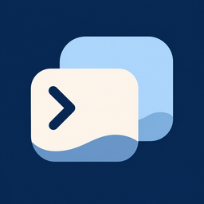

<p align="center">
  
</p>
<h1 align="center">Cove-Go</h1>
<p align="center">一个 App，连接 OpenClaw 与 DSH Remote。</p>
<p align="center"><b>简体中文</b> · <a href="README.en.md">English</a></p>
<p align="center">
  <a href="https://github.com/yukinsnow/Cove-Go/releases/tag/v0.1.15">下载 0.1.15（16）</a> ·
  <a href="docs/openclaw-remote.md">开发与架构说明</a> ·
  <a href="LICENSE">AGPL-3.0</a>
</p>

> **当前发布为 iOS 开发测试版、未签名 IPA。** 不是 App Store / TestFlight 版本，需要自行签名安装。已完成 GitHub Actions 和 Mac 本地 release 构建及归档检查，**尚未完成 iPhone 真机验证**。

## 这是什么

Cove-Go 是基于 [ccch1mneyyy/dsh-Go](https://github.com/ccch1mneyyy/dsh-Go) 开发的独立衍生客户端，直接基于原始上游，不基于其他 iOS fork。使用 Flutter 原生界面，在同一 App 中切换两种远程后端：

- **OpenClaw**：连接自己的 Gateway；支持多主机、设备配对、会话历史、流式回复、工具活动、模型选择、图片、排队消息、插话和打断。
- **DSH Remote**：保留上游远程连接和原生聊天；支持账号登录、自托管主机、SSH 以及 LAN / WebRTC / TURN / 中继（取决于服务端配置和网络）。
- 两套后端各自持有协议、身份、凭据和会话，不互相转换、不把一套服务伪装成另一套。
- 支持中文 / English、日间 / 夜间 / 跟随系统，以及独立绘制的小鲸鱼 / 小龙虾小伙伴。

本项目不是 OpenClaw、DSH Go 或 DeepSeek 的官方客户端。仓库保留上游 Android 和运行时代码供参考与开发，**本次发行仅提供 iOS 远程客户端**；不在 iPhone 上安装或运行本机 Linux / DSH 引擎，不提供 Android 无障碍手机操控。

## 下载与安装

前往 [GitHub Releases](https://github.com/yukinsnow/Cove-Go/releases/tag/v0.1.15)，下载：

- `Cove-Go-0.1.15-build16-6708c24dc8db-unsigned.ipa`
- 同名 `.ipa.sha256` 校验文件。

要求：**iOS 15.0+、arm64 设备**。使用自己信任的签名工具（例如 iLoader）和合法可用的签名身份安装；具体支持的系统、有效期、设备信任和开发者模式要求以签名工具及 Apple 规则为准。本项目不提供证书、共享账号或企业签名。

下载后可先校验：

```sh
# macOS / Linux，进入下载目录
shasum -a 256 -c Cove-Go-0.1.15-build16-6708c24dc8db-unsigned.ipa.sha256
```

签名会改变 IPA 内容，请在签名前校验。覆盖安装与钥匙串连续性取决于使用的签名身份和配置；**不要为更新随意卸载旧版**，卸载可能丢失本机配置。当前 bundle ID 为 `io.github.yukinsnow.dshApp`，产品改名不改变既有身份或存储键。

## 连接自己的服务

### OpenClaw

1. 添加 OpenClaw 主机，填写自己的 `wss://` Gateway 地址和令牌。直连远程明文 `ws://` 不接受。
2. 首次连接后，在 Gateway 批准该设备，再重连。客户端不会关闭或绕过配对与认证。
3. 也可选择 SSH，连接 SSH 服务器能访问的 Gateway（例如 `ws://127.0.0.1:18789`），由加密隧道转发；核对 SSH 主机指纹。
4. 侧栏按 Gateway 分组展示会话，按最新会话活动排序；运行中显示旋转指示，不再提供未读筛选或未读圆点。

### DSH Remote

从主机选择器进入 DSH Remote，使用自己的远程账号或自托管配置添加主机。需先在电脑 / 服务器上准备相应 DSH Remote 服务；App 不附赠后端或模型额度。首次访问局域网电脑时，请允许 iOS 本地网络权限。

## 安全与隐私边界

- 设备私钥、令牌与 SSH 凭据由本机系统安全存储管理；不要在 Issue、截图、日志或公开链接中粘贴它们。
- 聊天、图片和文件会发送到所选择的后端；后端及其模型服务商如何保存、处理数据，由对应服务的配置和政策决定。
- 历史快照按主机隔离并加密；图片回退缓存受容量限制，**不是完整备份**。
- 不要把未受保护的 Gateway 暴露到公网。iOS 挂起 App 后不保证后台长连接。

## 0.1.15（16）与验证状态

- 统一 Cove-Go 名称与 D9 深海配色 + D14 海浪图标；独立的关于页保留上游署名。
- 双后端切换、多 Gateway 隔离、SSH 接入；图片历史恢复、附件入口收起键盘、可选换行键发送。
- 会话侧栏分组、按最新活动排序、运行状态指示。
- 发布包来自 [GitHub Actions run 42363292967](https://github.com/yukinsnow/Cove-Go/actions/runs/42363292967)，源码提交 [`6708c24dc8db`](https://github.com/yukinsnow/Cove-Go/commit/6708c24dc8dbdc51fdaadcd4cacfdb06bf798545)，标签 `v0.1.15` 精确指向该提交。后续首页文档整理不改变这个二进制。
- 已检查 ZIP CRC、SHA256、版本、bundle ID、iOS 最低版本、arm64、图标及未签名状态。Mac 独立构建也成功；Release 只提供一个已校验的 GitHub 构建，避免混淆不同构建摘要。
- 相关回归一轮 71 项通过；共享抽屉另有 15 项 golden 与修改前基线呈相同像素差异，未改基准掩盖。**这不是全套测试通过或真机通过的声明。**

尚未完成：OpenClaw 原生审批 / 提问面板、语音、内联 widget、设备能力调用与历史分页（当前最近 150 条）；DSH Remote 的 iOS 真机端到端验收。请先用测试后端试用，不作为唯一生产运维入口。

## 从源码构建

使用 **`openclaw` 默认分支**；复现当前发行包请检出 **`v0.1.15`**。保留的 `main` 分支是上游 Android 基线，不是 Cove-Go 的发布入口。

```sh
git clone https://github.com/yukinsnow/Cove-Go.git
cd Cove-Go
git checkout v0.1.15
# macOS + Xcode + Flutter 3.47.9 / Dart 3.13.7
bash tooling/build-openclaw-ipa.sh
```

输出位于 `build/openclaw/`。入口为 `app/lib/main_openclaw.dart`，编译参数包含 `REMOTE_DUAL_APP=true`。脚本从已批准的图标原稿生成 iOS 图标，并排除受限上游桌宠资源。不同工具链构建不保证二进制逐字节一致。GitHub workflow 只生成 Artifact，公开 Release 由维护者另行整理发布。

源码目录：`app/lib/openclaw/`（双后端界面）、`packages/openclaw_client/`（Gateway 协议）、`packages/dsh_client/` 和 `packages/dsh_remote/`（上游 DSH 协议）、`tooling/`（构建）。更多检查与兼容性说明见[开发文档](docs/openclaw-remote.md)及 [CONTRIBUTING.md](CONTRIBUTING.md)。

## 许可证、品牌与致谢

- 项目源码遵循 **[AGPL-3.0](LICENSE)**；发行修改版应提供对应源码、保留许可和版权声明，并履行适用义务。免费不等于可以忽略授权。
- 上游作者 **[ccch1mneyyy](https://github.com/ccch1mneyyy)** 与社区提供了 DSH Go 基础；第三方代码和组件遵循各自许可，见 [THIRD_PARTY_NOTICES.md](THIRD_PARTY_NOTICES.md)。
- 上游 DSH Go 标识、Deepy、鲸娘等受限素材**不随源码 AGPL 一并授权**，见 [ASSETS.md](ASSETS.md)。当前 IPA 排除了列明的受限鲸鱼 / 桌宠目录；Cove-Go 海浪图标和新绘制小伙伴不使用那些素材。仓库中保留的上游素材不是供衍生产品自由使用的素材库。
- 本次是 GitHub 测试版发行，**不代表已解决 App Store 条款兼容性、完成 iOS 全依赖许可审计或取得上架批准**。iOS 原生 WebRTC 等依赖仍需按实际发行物继续核对。

反馈请到[本仓库 Issues](https://github.com/yukinsnow/Cove-Go/issues)。提交前遮盖凭据与个人内容；目前不接受外部 Pull Request。
